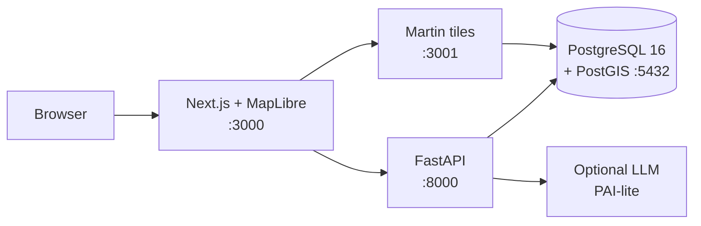
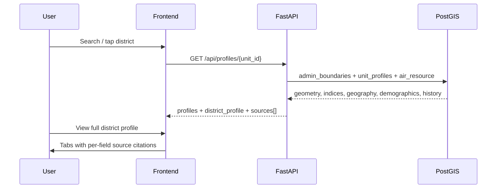
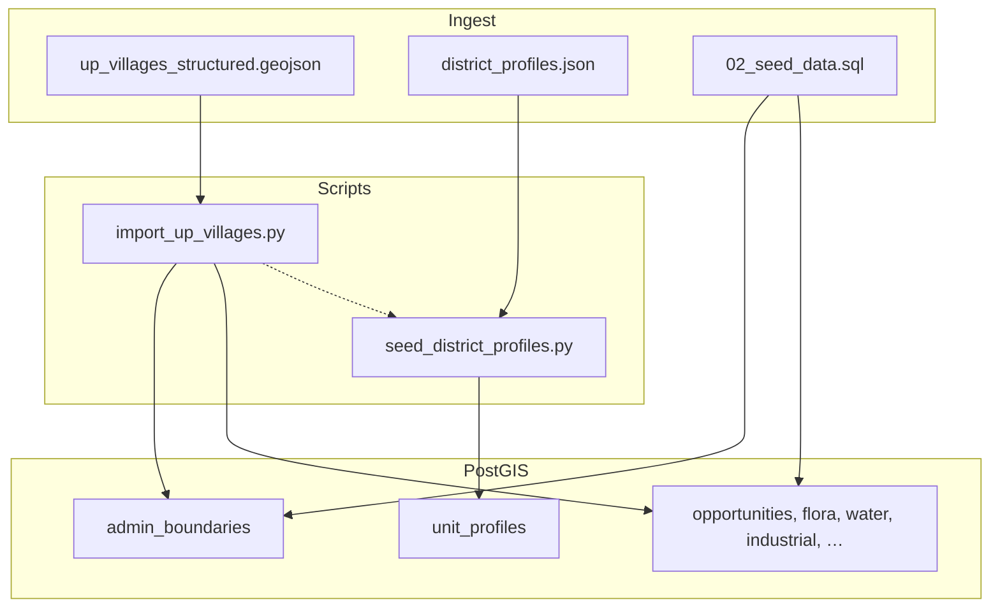

# Technical Design Document — PRIS + adcGIS

**Prajna Regional Intelligence System** combined with **adcGIS**  
Statewide spatial intelligence for Uttar Pradesh · Hack for Social Cause (vbyld 2027)

| Item | Detail |
|------|--------|
| Version | 0.3 (district full profiles) |
| Scope | Entire state of Uttar Pradesh (district → block → village) |
| Stack | Next.js, FastAPI, PostgreSQL 16 + PostGIS, Martin vector tiles |
| License | MIT |

---

## 1. Problem & social impact

Rural and peri-urban communities, local planners, and social enterprises often lack **one place** to see:

- What the land and water can support  
- Who lives there (demographics, skills, literacy)  
- Historical context that shaped the place  
- Ranked livelihood opportunities grounded in spatial data  
- **Sources** for every claim (Census, CGWB, IMD, ASI, gazetteers)

PRIS + adcGIS turns administrative geography into a **community intelligence layer**: map + multi-profile unit + cited district profiles + opportunities + downloadable briefs. Design principle: **where we have no data, we say so — we never invent numbers.**

---

## 2. Users

| User | Primary need |
|------|----------------|
| Community member / entrepreneur | “What can I start here?” with setup steps |
| Local planner / student researcher | District profile with geography, demographics, history + sources |
| NGO / social enterprise | Opportunity scores, conservation and sustainability context |
| Judge / reviewer | Reproducible Docker demo, clear architecture, cited data |

---

## 3. System architecture

### 3.1 High-level components



| Service | Host port | Role |
|---------|-----------|------|
| **frontend** | 3000 | Map, search, profile panel, opportunities, PAI chat, downloads |
| **api** | 8000 | REST: spatial search, profiles, opportunities, PAI, export packs |
| **martin** | 3001 | Vector tiles from PostGIS geometries |
| **db** | 5432 | Admin hierarchy, profiles, layers, provenance |

All services are defined in `docker-compose.yml` and start with one command.

### 3.2 Request flow (district profile)



### 3.3 Data pipeline



---

## 4. Data model (core)

### 4.1 Administrative hierarchy

`admin_boundaries` — `level` ∈ {state, district, block, village, suburb}

- Geometry: `MultiPolygon` (EPSG:4326), centroid  
- Codes: `district_code`, `block_code`, `village_code`  
- Attributes: `population`, `area_sqkm`, `properties` JSONB  

District polygons are **rebuilt from village unions** after full import (no axis-aligned bbox artefacts).

### 4.2 Unit profiles (multi-profile + district full profile)

`unit_profiles` — one row per admin unit:

| Column group | Purpose |
|--------------|---------|
| Domain JSONB (`soil_profile`, `water_profile`, `human_capital`, …) | Intelligence layers for indices & opportunities |
| **`geography`**, **`demographics`**, **`history`** | Full district profile (narrative + indicators) |
| Numeric indices | entrepreneurship, industrial_suitability, sustainability, conservation_value, overall_opportunity |
| Provenance | `profile_source`, `profile_version`, `confidence`, `review_status`, `computed_at` |

**Field convention** (district profile JSON):

```json
{
  "literacy_rate": {
    "value": 77.3,
    "unit": "%",
    "year": 2011,
    "source": "Census of India 2011 – District Census Handbook",
    "confidence": 0.95
  }
}
```

Every quantitative or narrative claim carries a **source**; the API also returns a de-duplicated `sources[]` list for the “All sources cited” tab.

### 4.3 Other tables (summary)

- `air_resource` — air volume as asset (solar, drone corridor, heritage sensitivity)  
- `opportunities` + `opportunity_setup_steps`  
- `industrial_assets`, `sustainable_projects`, `flora_fauna`, `water_soil`, `conservation_zones`  
- `intelligence_packs` — export metadata  

---

## 5. API surface (selected)

| Area | Endpoints |
|------|-----------|
| Health | `GET /health` |
| Search | `GET /api/spatial/search`, hierarchy / unit |
| Profiles | `GET /api/profiles/{unit_id}`, list, summary |
| Layers | opportunities, flora-fauna, water-soil, industrial, … |
| PAI-lite | `POST /api/pai/chat` (grounded; no key → deterministic fallback) |
| Export | `GET /api/export/{unit_id}/pdf|csv|geojson|pack` |

Interactive docs: `http://localhost:8000/docs`

---

## 6. Frontend structure

- **MapView** (MapLibre) — districts, layers, selection  
- **SearchBar** — place search  
- **ProfilePanel** — scores, **View full district profile** (geography / demographics / history / sources), domain tabs, air volume  
- **OpportunityCards**, **PaiChat**, **PlantUpload**, download bar  

i18n: English + Hindi keys in `frontend/src/lib/i18n.ts`.

---

## 7. District full profile design

**Goal:** Professional GIS-style district dossier usable by non-experts.

Sections:

1. **Geography** — topography, hydrography, climate, natural resources, built environment  
2. **Demographics** — population, density, growth, sex ratio, literacy, urban share, workforce, languages, religions  
3. **History** — foundation, economic evolution, geopolitical shifts, cultural heritage, milestones  

**Sources** used in the curated pack (`data/district_profiles.json`): Census of India 2011, CGWB, IMD, ASI/UNESCO, District Gazetteers, NHAI/MoRTH, UP SDMA/NDMA, India-WRIS, official district portals.

Pilot packs: Lucknow, Agra, Varanasi, Ayodhya, Gorakhpur, Kaushambi. Other districts keep index seeds until packs are added.

---

## 8. Security & honesty

- No fabricated statistics: empty profile → explicit UI message  
- Provenance and confidence on profile and layer rows  
- PAI-lite answers only from retrieved, tagged data (or states data is missing)  
- Demo DB credentials are local-only defaults (see README); change for any shared deployment  

---

## 9. Deployment model

Single-host Docker Compose for demos and hackathon judging. Production would separate secrets, TLS, backups, and read replicas; the schema and API contract remain the same.

---

## 10. Future work (post-submission path)

1. Expand `district_profiles.json` to all ~75 UP districts from primary portals  
2. Derive composite indices from structured profile fields (not seed scores only)  
3. Block/village roll-ups of district context  
4. Automated regression tests on profile API shape  

---

*This document describes the system as implemented in the repository. For run steps and environment variables, see the project README. For sample data and manual test cases, see `docs/SAMPLE_DATA_AND_TEST_CASES.md`.*
